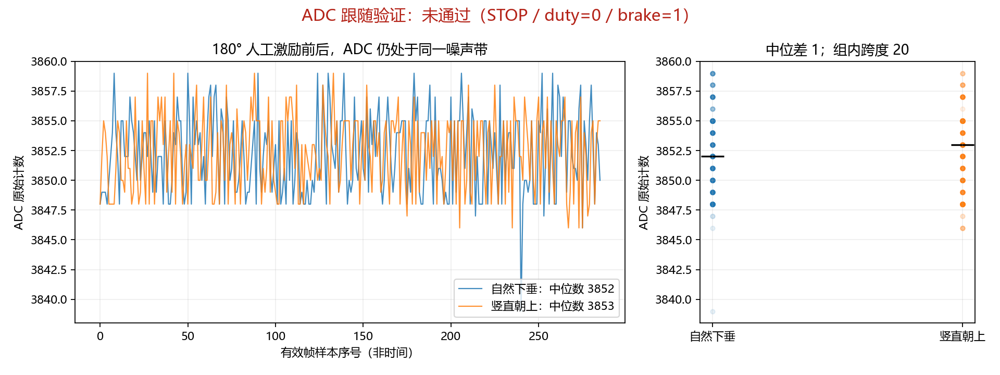

# 2026-10-23～24 ADC诊断记录（旧板证据归档）

> **状态更新（2026-10-24）**：用户报告 ADC 引脚损坏后，已更换相同型号的新板，并确认新板12V关闭、USB保留、ARM/STOP、未按KEY1。本机只枚举FTDI COM9，未发现GD32调试口COM7/DAPLink；新板尚未读取或写入。本文其余设备数据、UID、Flash/固件身份和供电记录全部属于旧板历史。当前执行入口见 [NEXT_SESSION.md](NEXT_SESSION.md)。

## 旧板结论快照（2026-10-24更换新板前）

**用户现场确认旧板“芯片的adc引脚烧毁了”；随后已换相同型号新板。**损坏诊断由用户提供，失效检测过程未纳入本轮工具原件，不称为SWD独立定位，也不推断致损原因。以下仍是旧板快照：最后核实为单次CH8诊断B，尚未回A；生产A的128KiB备份保留。B安装全128KiB比较记录一致后fresh reset Running，首4KiB SHA256为`74ab5ec6736f3b2ad3626f4e3f55328de1677bfb7458897a207427defbd999af`。12V关闭320点只证明转换推进；B真实跟随未验，不判A/B胜负，不标定或启动电机。新板需重新建档和做真实姿态跟随验收。

旧板最后一次用户明确供电确认：**12V关闭、USB保留、ARM档、STOP、不按KEY1**。请求恢复12V后收到“明天继续，写状态和交接”，没有执行确认。新板当前安全状态已由用户确认；但GD32调试接口尚未枚举，故未读写新板。旧板切ARM后未重新读取FPGA UserCode或电机遥测，STOP仅为旧板当时的用户确认。

> 以下均保留为用户确认引脚损坏前的实验历史：23日记录对应生产A，24日A/B准备对应B安装前，收工段对应发现硬件原因前。各段的“当前/未烧B/根因未定位/下一步A/B”只在当时成立，不能覆盖上面的最新用户结论和修复后流程。详细独立核算见[INDEPENDENT.md](INDEPENDENT.md)追加R7/R8。

## 固定输入与离线证据

- 父 Git 仓库 `D:/GitHub/xiangmu/FPGA`，本轮开工 HEAD `8bc71ff`；活跃 `verilog/` 副本原先整体未跟踪。另一个正式仓库有用户暂存/未提交改动，本轮未操作。
- `source_snapshot.json` 冻结 23 项源码/输入；本轮未修改控制 RTL 或 GD32 固件源码。
- 14 个现有 testbench 首轮 **13/14**，`loc_target_tb` 在 90.091 秒超时。相同二进制用 `vvp <file> -none` 禁用波形补验，45.913 秒 PASS；历史首轮结果仍保留。
- Gowin 构建完成，50 MHz 约束，Setup/Hold 违例端点均 0，TNS 均 0，Fmax 53.911 MHz；仍有既有警告，不能表述为零警告。
- 新位流 `fpga_project/impl/pnr/fpga_project.fs`：UserCode **0xFD3D**，SHA256 `63cae0ec4fc8b4af6bb5c7f3dc1138d70bd7a411aa96de4b4275b38186eb6173`。
- 独立验证记录见 [INDEPENDENT.md](INDEPENDENT.md)。独立发现 `loc_target_gen` 的 8 位分频器不能容纳 DIV=500，属于另项既有问题，本轮未修改。

## FPGA 恢复与停止态

最初实际板上 UserCode 为 **0x0A37**；8 秒采集只有 80 字节、合法新协议遥测 0 帧。用户关 12V 后加载新 SRAM 位流；首次相对路径命令失败，改绝对路径成功，随后设备读取确认 **0xFD3D / Status 0x6020**。这些前后日志均保留。

`after_sram.bin`：381 个合法帧，序号无断裂，全部 **STOP / duty=0 / enable=0 / braking=1 / link=1**。这只证明该次采集的停止联锁及序号链路，不证明角度反馈正确。

## ADC 跟随原件

| 用户保持的姿态 | 原件 | 帧数 | ADC 范围 | 中位数 |
|---|---|---:|---|---:|
| 初次自然下垂 | `hanging.bin` | 286 | 3827–3855 | 3849 |
| 初次竖直朝上 | `upright.bin` | 285 | 3826–3853 | 3846 |
| 固定联轴器后下垂 | `hanging_fixed.bin` | 286 | 3839–3859 | 3852 |
| 固定联轴器后朝上 | `upright_fixed.bin` | 286 | 3846–3859 | 3853 |

以上完整帧全部 STOP、duty0、enable0、braking1、link1、序号连续。固定后的中位差 **1**，小于组内跨度 **20**。不能称机械修复已解决问题。

复跑命令（当前预期 **exit 1**，表示明确复现未跟随）：

```powershell
python docs/verification/2026-10-23/verify_adc_follow.py docs/verification/2026-10-23/hanging_fixed.bin docs/verification/2026-10-23/upright_fixed.bin --output docs/verification/2026-10-23
```

诊断门槛为：每组至少 100 个连续 STOP/link 帧，姿态中位差 > `max(200, 3×组内最大跨度)`。200 counts 用于把交接所需的“几百 counts”大范围响应与噪声分开，**不是角度标定参数**。当前即使用只要求“大于噪声”的弱门槛也仍不通过。



图片横轴仅是有效样本序号；没有采用旧 SPI 固定周期推算当前 UART 数据时间。

## 2026-10-23生产A Flash身份：已经独立核实（历史）

只读命令（无 Flash 擦写、无 GO）：

```powershell
python docs/verification/2026-10-23/read_current_flash.py
```

首次等待按键 180 秒超时，记录在 `gd32_read_attempt1.{log,json}`。收到用户按键完成后再次打开，握手首试成功，设备 ID **0x0414**。

两遍读取 `0x08000000..0x08000FFF`，各 **4096 字节完全一致**：

```text
ac8d72a7021c2186e41af56eed80b9d181a6ca4943dd206d61b17de33952d1ae
```

向量表 SP=`0x20008000`、Reset=`0x08000131`。独立验证者自行解析 HEX 和 ELF32，确认正式 UART 的 **3300 个已定义加载字节全部匹配**，扫描版的 3524 个地址中有 **2730 字节差异**。其他候选均不匹配。

边界：只覆盖前 4 KB；“匹配”指候选 HEX/ELF 定义的地址，不能称整片 Flash 都与某镜像一致。读回工具的命令白名单只允许 GET/GET_ID/READ，独立 Mock 对照验证拒绝 GO/WRITE/ERASE/UNPROTECT。打开串口及 RTS/DTR 操作可能改变复位/启动状态，“只读”不等于不扰动运行。

历史 `_tools/_readback_20261021.bin` 与扫描版完全匹配，只能说明 10 月 21 日的状态，**不能作为当前故障根因**。本轮没有重刷正式固件。

## GD32 直接输出与后续探针

首次尝试从 ROM GO 返回应用时 GetID 收到 NACK，尚未发送 GO；失败脚本与日志保留为 `capture_gd32_debug_attempt1.py`、`gd32_cn1_attempt1.log`。随后改为用户只点按 SW4 正常复位，串口保持打开，仅接收数据。

`gd32_cn1_12v_off_normal.bin`：8.008 秒，400 条合法 `Axxxx` 行，ADC 3842–3855、中位数 **3848**，SHA256 `74620e8e29c1f533810f6955e335e387c8f2caad5e5877d75d6d64694512676e`。这是 **12V 关闭状态**，尚无同时段姿态激励，不能直接代替上电后的跟随验证。

静态审查已确认当前规则组连续采样配置与官方 SDK 调用一致，尚未证实触发错误。持续大阶跃会在最多 16 次主循环接受；这不是 16 个已确认的新转换。两字节来自同一 ADC 快照。`link=1` 只证明序号新鲜，固件没有显式暴露转换完成计数、校准超时或采样年龄，下一步需要运行态观察，不能靠盲调 offset 修复。

优先探针为 SWD attach 读取 ADC0 `STAT/CTL0/CTL1/SAMPT1/RSQ0/RSQ2/RDATA` 与 `g_adc`，先确认工具不自动解保护、擦写、复位或停机。相关地址已从本机官方头文件和匹配 Flash 的 ELF 核实，见独立追加记录。若无法建立无修改观察通道，如实记录限制，不把缺观测当作故障结论。

## 运行态阳性对照：通过且恢复

实际执行 `python docs/verification/2026-10-23/adc_runtime_control.py`，只暂改ADC0 CTL1、SAMPT0、RSQ2三个易失应用寄存器，CH8→片内参考CH17→CH8。pyOCD attach另有必要的调试控制写，不声称目标完全无写。执行前脚本经独立审查及8种内存故障注入：旧版恢复异常会中断的阻塞结论保留，新版恢复最多3轮并独立检查末态后才通过。

| 阶段 | 点数 | RDATA范围/中位 | g_adc范围/中位 |
|---|---:|---|---|
| CH8切换前 | 60 | 3824–3834 / 3829 | 3824–3835 / 3830 |
| 片内参考CH17 | 60 | 1492–1498 / 1494 | 1492–1498 / 1494 |
| 恢复CH8 | 60 | 3823–3835 / 3828 | 3824–3833 / 3828.5 |

三个寄存器保存/恢复完全一致：CTL1=`0x001e0003`、SAMPT0=`0`、RSQ2=`8`；无恢复/末态检查错误，末态Core Running。前4KiB Flash哈希前后均为`ac8d72a7021c2186e41af56eed80b9d181a6ca4943dd206d61b17de33952d1ae`，运行态前后未另存Flash原件，仅有哈希记录。两名独立角色实际重算180点一致。**支持ADC原始转换与g_adc链路能响应通道切换，不等于外部角度跟随通过。**


## 12V恢复后的三姿态直接SWD采集：未跟随

用户恢复12V后，保持ARM档/STOP/不按KEY1，依次下垂、扶到朝上、返回下垂。`read_adc_runtime.py`绕开FPGA解帧，分别读RDATA低12位与g_adc。两次读数不是同步快照，小差值不能判定滤波问题。

| 姿态 | 原件 | 点数 | RDATA范围/中位 | g_adc范围/中位 |
|---|---|---:|---|---|
| 下垂 | runtime_hanging.json | 492 | 3820–3834 / 3827 | 3820–3833 / 3827 |
| 朝上 | runtime_upright.json | 505 | 3822–3835 / 3828 | 3822–3835 / 3828 |
| 返回下垂 | runtime_hanging_return.json | 491 | 3822–3835 / 3829 | 3821–3836 / 3829 |

共1488点；六项起始寄存器、连接选项、采集前Flash前4KiB哈希均一致，RSQ2=8、PB0模拟模式；起始与末尾Core Running。仅有起始配置/Flash检查和起止运行态检查，不能宣称全程持续不变。首轮下垂因pyOCD改变CWD而未能保存JSON的失败保留于`runtime_hanging_attempt1.log`；先resolve绝对输出路径后重采成功，失败未覆盖。

朝上与两次下垂中位数均只差1；RDATA最大组内跨度14、g_adc为15。离线门槛与此前保持一致，要求差>max(200,3×跨度)，两字段均未通过。独立验证者自行复算三组原始点与摘要一致。

```powershell
python docs/verification/2026-10-23/verify_adc_runtime.py
# 实际：control_pass=true, usable=true, adc_follow_pass=false；exit 1（预期红灯）
```


不能把该结果归因为FPGA解帧或g_adc滤波冻结，也不能直接认定传感器、接线或芯片损坏。按用户确认的硬件边界，继续只核对可证伪的软件假说。已发现一条文档陷阱：当前固件注释把PB1/J2当备用口，但G1官方第7页原理图PB1接LCD_BLK并经R8驱动Q1，并非PB0所处H6外部口，不能盲改通道9。

## 未完成（截至上述三姿态实验）

真实角度未跟随的根因、ANG_OFFSET 标定、用户启动后的起摆/平衡验证均未完成。运行态片内阳性对照已通过，不能将这个局部通过当作倒立验收。当前12V已由用户恢复，保持STOP且不按KEY1；下个探针须先限定变更与恢复范围。

## 2026-10-24安装B前历史：真实OUT配对、软件回归与A/B准备

当时现场：用户为A/B重新确认**12V关闭、USB保留、ARM档、STOP、不按KEY1**。此准备阶段尚未烧B，仍为A；随后安装与收工状态见下节。详细版本链、三条可证伪假说、原件与回退边界已固化到[ADC_REGRESSION.md](ADC_REGRESSION.md)。

用户指出供电激励前提后，先做输入确认，未继续新ADC寄存器写探针。“0–3V”后被明确为J1-2 OUT随杆变化，不是J1-1电源变化。按用户万用表保持OUT=0.5V和实际2.0V，分别只读采512/474点；RDATA中位3800/3829，g_adc为3799/3829。1.5V输入差只对应29/30计数，外部响应仍未恢复。两组各约6秒，独立实际回放、986点与JSON/PNG一致；没有PB0现场电压，不定位差异节点、不推断硬件损坏。


按用户最新纠偏查软件回归：10-16 UART改写确实漏RCU_ADC0，17日14:35补回；当前运行已开启，故历史缺陷不等于当前根因。已找到17日16:58中间版规则连续+注入读取原件，未找到18:21最终版或21日改动前源码完整原件；不能把旧交接的“修复完成”当当前证据。旧SPI与当前UART的SystemInit及相关5个ADC/时钟配置函数机器码一致。

新备份脚本实际读取指定128KiB两遍，记录哈希均为`8e4d6b716146250a260a004b9702edec727046e0302d38acb99ae3701717a824`。仅保存第一遍bin，独立复算131072B、前4KiB同A、前16KiB同docs下10-21 UART读回，偏移4096后全FF；不据此声称已读出物理总容量。脚本仅显式读，attach仍有调试控制操作。

候选B独立放`adc_single_trial/`，未覆盖生产源码或build_uart。保留CH8、239.5周期、时钟、GPIO、UART及滤波，只改显式单次触发/EOC等待并新增计数。独立纯内存执行实际ELF12场景、3观察者阴性对照通过；3408加载字节与HEX一致。B尚未上板，此通过只批准STOP诊断资格。超时可能清滤波hold；需同时记录完成/超时计数，不能只凭g_adc不变否定B。

旧自制ISP擦写路径被独立阻塞，禁止复用。官方CB Pack离线解析的Flash边界128KiB、2KiB擦除扇区与1KiB ProgramPage已核；新编程器计划仅首4KiB、显式sector模式、全范围逐字节校验、失败最多一次原备份回退。观测器只读RAM计数/输出，不读STAT/RDATA。两脚本须各自独立故障注入通过后才真实执行。

版本管理：续接发现外部暂存17935路径，保持他人暂存不动，本阶段未git add/commit/reset。当前根因仍未定位，标定/起摆仍禁止。

## 2026-10-24收工：B已运行，真实跟随留待下次

用户最后指令“明天继续，写状态和交接”。本轮硬件操作停止；最新明确确认12V关闭、USB保留、ARM档、STOP。恢复12V请求没有得到执行确认，不能写成B已上电。下次唯一入口：[NEXT_SESSION.md](NEXT_SESSION.md)。

独立修后编程器27真实API内存场景+2消融反例、观察器39场景及100k配置7场景通过后，真实执行`program_adc_trial.py`安装B：仅首两个2KiB扇区，全128KiB比较记录一致（SHA`2859b0fd70dd40b9ee2fb7227d87cab4b56b1dd6272421d0da73422b732b0115`），fresh reset后Running，无回退。A原131072B备份完整保留。Flash容量实读128KiB/SRAM32KiB。实际1MHz attach失败，100k成功，两次原件并存；SVD线程XML异常与BoardID/CoreSight警告保留。

B断电采集320点/6.0099308s，g_adc范围3835–3855/中位3849.5，completed增430791、timeout增0、无计数断续。B首4KiB采前/后均SHA`74ab5ec6736f3b2ad3626f4e3f55328de1677bfb7458897a207427defbd999af`，单次CH8配置前后相同、起止Running。独立角色从ELF构造期望B及逐点核算一致。此数据仅证明无激励下转换推进，**不是角度跟随修复通过**。实际读取均来自RAM/静态配置，不读RDATA消耗EOC。


原件：`adc_trial_install.json/log`、`adc_trial_12v_off.json/log`；原A备份：`gd32_full_flash_128k.bin`。B完整回读只保存比较结果/hash，未另存B全范围bin。生产main_uart.c/控制RTL/ANG_OFFSET未改；板上B与生产A身份不同，旧采集器不能混用。下次先确认现场和B身份，再上电下垂/朝上两组；失败按任务卡断电回A，不盲改offset。
